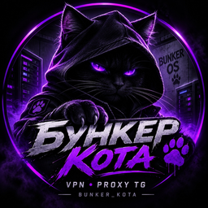

# 🐈‍⬛ BunkerVPN for Windows PC (10 / 11)

  

  <b>Официальный высокоскоростной клиент обхода блокировок для компьютеров и ноутбуков на Windows 10 / 11.</b> 
  Разработано сообществом <b>Бункер Кота 🐾 (1400+ подписчиков)</b>.

  
  
  
  
  
  
  

---

## ⚡ Главные возможности (Версия v1.0.11)

* 🛡️ **Полное устранение зависаний при отключении (Anti-Freeze):**
  * Процесс отключения переведён в полностью асинхронный фоновый поток (`Task.Run`). Интерфейс больше никогда не замирает и не блокируется.
  * Кнопка отключения мгновенно переходит в статус `ОТКЛЮЧЕНИЕ...` с блокировкой повторных кликов.
  * Безопасная очистка системных прокси WinINet без зависания UI-потока.
* ⚡ **Ультра-скорость и моментальная отправка сообщений (Zero-Lag):**
  * Фиксированный безопасный MTU `1360` (полная защита от дропа пакетов и задержек в Telegram/Discord).
  * Переход на `stack: "mixed"` (высокоскоростной gVisor для TCP + нативный стек для UDP).
  * Отключён `strict_route`, вызывавший конфликты шлюзов и задержки.
  * Раздельный DNS: защищённый DoH `https://76.76.2.11/p0` через прокси-туннель для зарубежных сервисов (защита от DNS-отравления провайдеров).
* 🔄 **Фикс встроенного обновления:**
  * Таймаут загрузки инсталлера в `UpdateService` увеличен до 10 минут (устранена ошибка `HttpClient.Timeout`).
* 🎨 **Редизайн и улучшение отображения:**
  * Устранена дубликация пинга в названии серверов (`CleanName`).
  * Новая плавная кнопка «ПОДКЛЮЧИТЬ / ОТКЛЮЧИТЬ» с закруглением 14px и неоновым свечением.
  * Включено аппаратное сглаживание шрифтов (`ClearType` / `Display`).
  * Полноценный ресайз окна мышкой и кнопка максимизации `🗖`.

---

## 📦 Скачать BunkerVPN v1.0.11

| Тип загрузки | Прямая ссылка (GitHub) | Зеркало для РФ (без VPN) | Описание |
| :--- | :---: | :---: | :--- |
| 📥 **Установщик (Setup.exe)** | [**Скачать Setup v1.0.11**](https://github.com/ANT1VEN0M/BunkerVPN-Windows/releases/download/v1.0.11/BunkerVPN-Windows-v1.0.11-Setup.exe) | [**Зеркало РФ (Setup)**](https://ghfast.top/https://github.com/ANT1VEN0M/BunkerVPN-Windows/releases/download/v1.0.11/BunkerVPN-Windows-v1.0.11-Setup.exe) | Рекомендуется. Устанавливает программу, создаёт ярлыки на рабочем столе и автозапуск. |
| 🧰 **Портативная версия (ZIP)** | [**Скачать Portable v1.0.11**](https://github.com/ANT1VEN0M/BunkerVPN-Windows/releases/download/v1.0.11/BunkerVPN-Windows-v1.0.11-Portable.zip) | [**Зеркало РФ (Portable)**](https://ghfast.top/https://github.com/ANT1VEN0M/BunkerVPN-Windows/releases/download/v1.0.11/BunkerVPN-Windows-v1.0.11-Portable.zip) | Не требует установки. Распакуйте архив в любую папку и запустите `BunkerVPN.exe`. |

---

## 🚀 Быстрый старт

1. Скачайте установщик `BunkerVPN-Windows-v1.0.11-Setup.exe` (или распакуйте Portable ZIP).
2. Запустите приложение (при запросе UAC разрешите запуск от имени администратора для работы драйвера WinTUN).
3. Нажмите большую оранжевую кнопку **«ПОДКЛЮЧИТЬ»**.
4. Проверьте задержку серверов на вкладке **«Серверы»** или нажмите **«📶 По пингу»** для автосортировки лучших узлов.

---

## 💖 Поддержка проекта Бункер Кота (Донаты)

Бункер развивается полностью независимо на чистом энтузиазме! Если BunkerVPN помогает вам оставаться на связи на максимальной скорости — поддержите проект:
- 💳 **Перевести по СБП (Озон Банк в 1 клик):** [https://finance.ozon.ru/apps/sbp/ozonbankpay/01a1daa7-59df-7009-9fee-796763044ce6](https://finance.ozon.ru/apps/sbp/ozonbankpay/01a1daa7-59df-7009-9fee-796763044ce6)
- 🚀 **Прокачать канал (Telegram Boost):** [https://t.me/boost/BUNKER_KOTA](https://t.me/boost/BUNKER_KOTA)
- 💎 **Криптовалюта (USDT / TON) и связь:** [@k0tlux](https://t.me/k0tlux)

---

## 👑 Сообщество Бункера Кота

- 📢 **Telegram-канал:** [@BUNKER_KOTA](https://t.me/BUNKER_KOTA) *(1400+ подписчиков)*
- 💬 **Чат сообщества:** [@BUNKER_K0TA](https://t.me/BUNKER_K0TA)
- 👑 **Создатель:** [@k0tlux](https://t.me/k0tlux)
- 🤖 **Android-клиент (v1.4.2 Hotfix):** [BunkerVPN для Android](https://github.com/ANT1VEN0M/BunkerVPN)
- 📡 **Сетевой монитор:** [Bunker URL Test v1.1.2 Universal](https://github.com/ANT1VEN0M/Bunker-Url-Test)
- 🌐 **Официальный веб-портал:** [Bunker Auto-Engine](https://ant1ven0m.github.io/Bunker-Auto-Engine/)
- 🔌 **Telegram-плагины:** [Bunker Neon Loader & Chat Translator](https://github.com/ANT1VEN0M/Bunker-Auto-Engine/tree/main/plugins)
